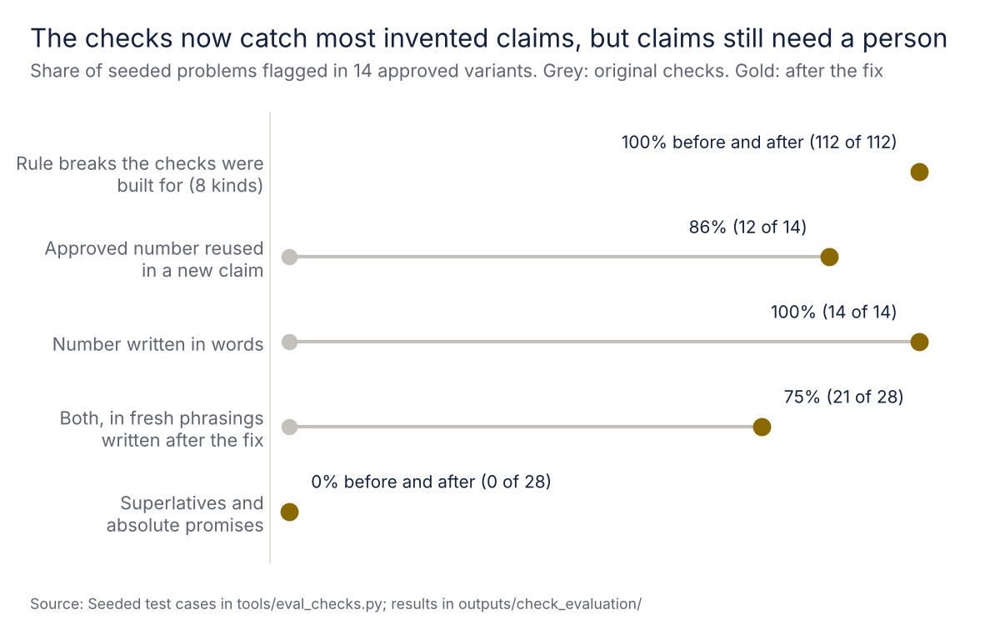

# Marketing Workflows: Reusable AI Workflows for a B2B SaaS Marketing Team

A shared library of AI marketing workflows, organised so any AI coding assistant can run them consistently and a whole team can improve them over time. Business knowledge lives in one place, each task is a reusable skill, agents chain skills into pipelines, and Python checks catch the mistakes AI tends to make before anything reaches a customer.

Built around **Tallyroot**, a fictional practice management software company for small accounting firms. Everything here is generic and invented for demonstration.

## Why a repo instead of a prompt doc

Prompts kept in personal notes or chat history cannot be traced, repeated or improved by a team, and they disappear when someone leaves. A repo gives the team:

- **Shared context:** the ICP, messaging and brand rules are written once and read by every workflow, so nobody re-explains the business in each chat
- **Reusable skills:** one skill (for example, "score ad variants") serves several pipelines
- **Version history:** every change to a prompt is recorded, and new versions are tested on a branch before replacing what works
- **Checks a model cannot skip:** character limits, banned claims, approved numbers and traceable figures are enforced in code

## The four workflows

| Agent | What it does | Skills it chains | Checks | Example run |
|---|---|---|---|---|
| [Ad variant pipeline](agents/ad-variant-pipeline.md) | Brief to a short, ranked list of ad variants | generate angles, write variants, score variants, brand and compliance review | `check_copy.py` | [Client Portal for tax season](outputs/2026-11-23-client-portal-tax-season/) |
| [Landing page audit](agents/landing-page-audit.md) | Checks a page delivers what the ad promised, with ranked fixes | audit landing page | `audit_page.py`, `verify_numbers.py` | [Client Portal page](outputs/2026-11-23-landing-page-audit/landing_page_audit.md) |
| [Release to in-app](agents/release-to-in-app.md) | Turns a release note into in-app messages per customer segment | write in-app message, brand and compliance review | `check_copy.py` | [Smart Intake bank statements](outputs/2026-11-23-smart-intake-bank-statements/) |
| [Morning campaign digest](agents/morning-campaign-digest.md) | A short daily note on campaigns behaving unusually | campaign anomaly digest | `campaign_anomalies.py`, `verify_numbers.py` | [Digest for 2027-01-21](outputs/2026-11-23-morning-digest/digest.md) |

Every agent ends at a **human review gate**: the workflows draft, check and recommend; people approve.

## What the checks caught in the example runs

| Run | What went wrong | Caught by | Fix |
|---|---|---|---|
| Ad variant pipeline | One variant invented "10 hours a week" and used the banned word "seamless" | `check_copy.py` | Rewritten with the approved "4 days faster" proof point |
| Ad variant pipeline | One headline used an exclamation mark and made a security claim without "SOC 2 Type II" | `check_copy.py` | Rewritten to the approved wording |
| Landing page audit | The draft audit contained an untraceable number; review also found the verdict miscounted the failed checks | `verify_numbers.py` and the review step | Verifier taught to ignore list numbering; verdict corrected |
| Morning digest | The digest stated how many campaigns were flagged, a number the facts file did not contain | `verify_numbers.py` | The anomaly tool now outputs the flagged count, so the writer never has to compute it |

Full history: [`outputs/run_log.md`](outputs/run_log.md). The point is not that the first drafts were perfect; it is that the system caught each problem before a human had to.

## Highlights from the example runs

- **Ads:** 10 LinkedIn variants across 5 angles, all passing the copy checks on the second round. The top 3 were chosen from different angles (offer, pain, capacity) so the test teaches which motivation works
- **Landing page:** the page failed all six checks, including a message match of 0.17 against a 0.5 minimum and 9 form fields for customers who are already signed in. Fixes are ranked by expected impact
- **In-app:** 4 messages for 2 segments passed the hard checks; the review step flagged one feature claim that went beyond the release note for product to confirm
- **Digest:** flagged a paid search campaign with zero conversions on $654.32 of spend (likely broken tracking) and a LinkedIn cost per click spike of 89.1%

## What it's worth

**The point of the checks is to let a reviewer stop checking rules and spend their time on claims.** To see how far that can be trusted, I seeded known problems into the 14 approved variants from the example runs and counted what the checks flagged ([`tools/eval_checks.py`](tools/eval_checks.py)).



- **The rules the checks were built for are fully covered:** 112 of 112 seeded rule breaks caught (length, banned words, invented numbers, dashes, exclamation marks, security and AI wording, overstated automation), with no false alarms on the 14 clean variants
- **The test found a real gap, now fixed:** the original check approved numbers on their own, so "Cut admin by 50%" passed because 50 appears in "5 to 50 staff", and "Save ten hours a week" passed because the number was written in words. Both kinds got through 0 of 28 times. The checker now approves each number together with the word that gives it meaning, and flags numbers written in words: 26 of 28 caught, and 21 of 28 on fresh phrasings written after the fix
- **What still needs a person:** a correct number in the wrong claim ("Join 310 firms", where 310 is the study's sample size, not its customer count), loose amounts ("dozens", "a third"), and superlatives or absolute promises ("the easiest portal", "never chase a document again"), which the checks catch 0 of 28 times. That is why every agent ends at a human review gate
- **First drafts fail often enough to matter:** in the example runs, 2 of 14 copy drafts failed the checks on the first round and both reports that state numbers failed verification on their first attempt. All four were fixed before a person saw them
- **Time back (planning estimate):** if a reviewer spends about 2 minutes per variant checking the mechanical rules by hand, a team producing 40 variants a week gets back about 70 hours a year, and spends its review time on claims instead

To rerun: `python tools/eval_checks.py --label before`, `python tools/eval_checks.py --label after`, then `python tools/make_charts.py`.

## How the repo is organised

```
AGENTS.md            start here: what the repo is, conventions, how to run an agent
context/             company, ICP, messaging, brand voice, ad rubric, compliance rules
skills/<name>/       SKILL.md per task: purpose, inputs, steps, output, checks
agents/              ordered pipelines of skills and tools (no prompts of their own)
tools/               Python checks: copy rules, page audit, anomaly facts, number verification, run log, check evaluation
charts/              README chart
inputs/              briefs, landing pages, release notes, daily campaign metrics
outputs/             one folder per run, plus run_log.md
tests/               tests for every check
```

[`AGENTS.md`](AGENTS.md) is the entry point. AI coding assistants read it first to learn the layout and rules, the same way a new teammate would.

## How to use it

1. Open the repo with an AI coding assistant
2. Ask it to run an agent, for example: "Run `agents/ad-variant-pipeline.md` on `inputs/brief_client_portal_tax_season.md`"
3. It follows the steps, runs each named check, and writes results to `outputs/`
4. Review at the human gate, then approve or send back

The checks also run on their own:

```bash
pip install pandas numpy pytest
python tools/check_copy.py outputs/2026-11-23-client-portal-tax-season/variants.json
python tools/audit_page.py inputs/landing_page_client_portal.md inputs/brief_client_portal_tax_season.md
python tools/campaign_anomalies.py inputs/campaign_daily_metrics.csv
python -m pytest -q
```

## Adapting it to a real team

- Replace the files in `context/` with your own ICP, messaging, brand voice and approved proof points
- Update `context/compliance_rules.md` and the limits in `tools/common.py` to match your channels and legal requirements
- Add a skill by creating `skills/<name>/SKILL.md`; add a pipeline by listing skills in a new file under `agents/`
- Improve a skill on a branch, run it on the same inputs, compare scores in `outputs/`, and merge only if it is better

## Limitations

- **Fictional company and sample data.** Context, briefs and metrics are invented to demonstrate the workflows
- **Checks cover what can be measured.** Tone, accuracy of feature claims and strategic fit still need human judgment, which is why every agent ends at a review gate
- **The landing page audit uses simple text measures** (term overlap, reading grade); it cannot judge design or page speed

## Licence

MIT. The company, people and data are fictional.
